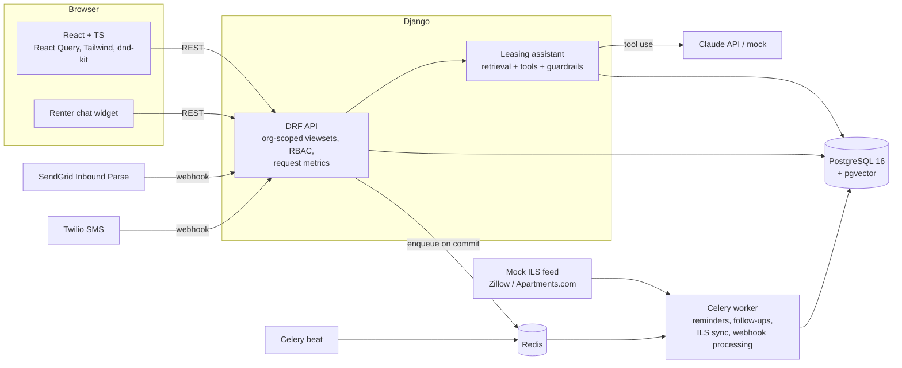
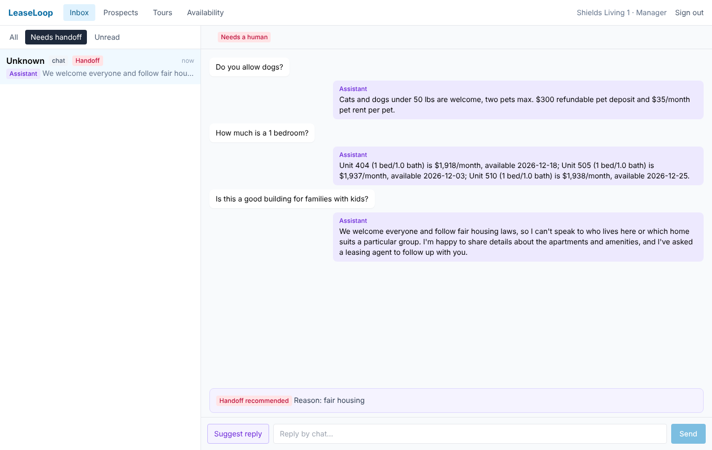
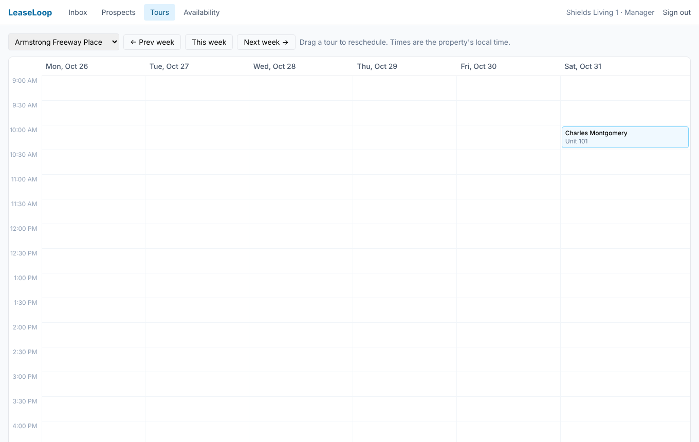
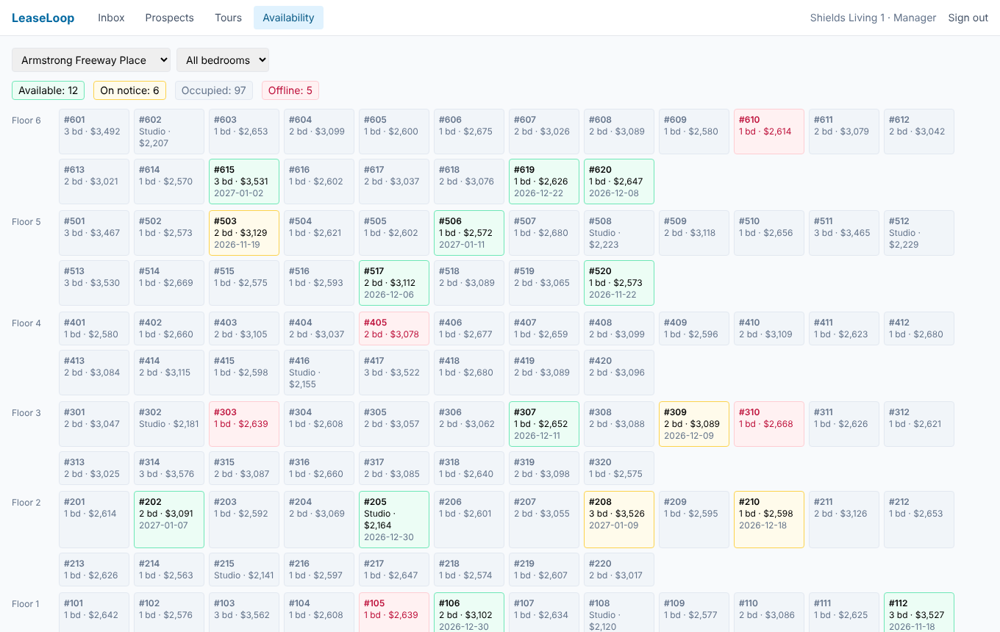
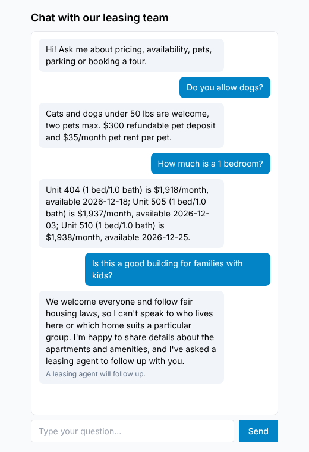

# LeaseLoop

LeaseLoop is a multi-tenant CRM for apartment leasing teams. It follows a renter from first
inquiry to signed lease:

- Email and SMS leads arrive through idempotent webhooks into a unified inbox.
- Agents work prospects, tours, applications and leases. Every query is scoped to their
  organization, and agents see only their own or unassigned leads.
- Background jobs send tour reminders and follow-ups, and sync leads from listing sites.
- An LLM leasing assistant answers renter questions from policy documents, reads live prices
  and availability through tool calls, books tours, and hands off to a person when it isn't
  confident or the question is out of scope.

It is built with Django and DRF, PostgreSQL with pgvector, Celery on Redis, and React with
TypeScript.

## Architecture



## Features

- **Multi-tenancy and RBAC.** A base viewset scopes every query to the caller's organization:
  other tenants' IDs return 404, and foreign-key references to them are rejected. Managers
  run the whole org. Agents see and edit only prospects and tours that are theirs or
  unassigned, and can't approve applications.
- **Renter journey.** The pipeline runs inquiry → prospect → tour → application (submit,
  approve) → lease (create, sign) → renewal. Each transition is guarded, so steps can't be
  done out of order.
- **Unified inbox.** Email, SMS and chat threads in one list, with handoff, unread and
  assistant badges. Agents reply on the thread's own channel and can ask the assistant to
  draft a reply.
- **Tour calendar.** Drag a tour to a new slot to reschedule it. The change shows instantly
  through an optimistic React Query update and rolls back if the server finds a conflict.
  Times are shown in the property's timezone.
- **Unit availability grid** by floor, with a status legend and a bedroom filter.
- **Idempotent webhooks.** SendGrid- and Twilio-shaped endpoints:
  - Twilio requests are verified with HMAC signatures, and SendGrid's with a URL secret.
  - Each delivery is recorded in a ledger with a unique `(provider, event_id)` and
    processed after commit.
  - Duplicate deliveries are no-ops.
- **Celery jobs** with `autoretry_for`, exponential backoff, jitter and `max_retries`:
  - 24-hour and 1-hour tour reminders;
  - stale-lead follow-ups;
  - ILS lead sync with cursors.

  Each job claims its work under a row lock and sends with a deterministic idempotency key.
- **Leasing assistant.**
  - Policy retrieval with pgvector.
  - Tools: `search_units`, `get_policy`, `check_tour_slots`, and `book_tour`, which
    re-validates the slot on the server.
  - Fair-housing, legal, complaint, negotiation, PII and prompt-injection pre-filters.
  - A post-check that blocks any price or unit number no source supports.
  - Handoffs that create a task and flag the thread in the inbox.
- **Observability.** Every request logs its query count, DB time, latency and request ID as
  JSON, and returns them in `Server-Timing` and `X-DB-Query-Count` headers. Slow or chatty
  requests log at WARNING.
- **OpenAPI** schema at `/api/docs/`, validated in CI with warnings treated as errors.

## Screenshots

| Unified inbox | Tour calendar |
|---|---|
|  |  |
| **Availability grid** | **Renter chat widget** |
|  |  |

These screenshots come from a scripted Playwright run against seeded demo data. More are in
[`docs/screenshots/`](docs/screenshots/).

## Quick start

```bash
cp .env.example .env
```
```bash
docker compose up --build
```
```bash
docker compose exec django python manage.py seed_demo --prospects 100000
```

- App: http://localhost:5173 (sign in as `manager@org1.demo` / `demo1234!`, or
  `agent1@org1.demo`)
- API docs: http://localhost:8000/api/docs/
- Chat widget: http://localhost:5173/chat/&lt;property id&gt;
- Sample webhooks: `python scripts/post_webhooks.py` posts each SendGrid and Twilio payload
  twice. The second delivery is answered `duplicate`.

The assistant uses a deterministic mock unless `LLM_PROVIDER=anthropic` and
`ANTHROPIC_API_KEY` are set in `.env`.

## Results

| Area | Result | Details |
|---|---|---|
| Backend tests (pytest-django) | 164 passing | models, tenancy (cross-tenant 404s), both roles, webhook idempotency, Celery retries and idempotency, assistant tools and guardrails, query counts |
| Frontend tests (Jest + RTL) | 15 passing | inbox, calendar (timezone, DST, optimistic update and rollback), availability grid |
| End-to-end (Playwright) | 1 flow | webhook lead → inbox → tour → application → approval → signed lease |
| Prospect list N+1 fix | 72 → 5 queries per page; p50 82.7 → 15.7 ms | [docs/perf.md](docs/perf.md) |
| Load test, 100K prospects, 100 users (~75 req/s) | p95 across all endpoints 176 → **55 ms** (p99 83 ms) | [docs/perf.md](docs/perf.md) |
| Assistant eval, 150 inquiries, **mock provider** | 87.3% accuracy, **0 hallucinated prices**, handoff precision 0.92 / recall 0.95 | [evals/results.md](evals/results.md) |
| Assistant eval, Claude | not run yet: needs an API key | `python evals/run_eval.py --provider anthropic` |

The mock-provider eval checks the pipeline, tools, guardrails and scoring. It doesn't measure
model quality. The performance numbers were measured on a 4-vCPU container, with the load
generator on the same machine. See each linked page for the setup and caveats.

## Development

```bash
cd backend && python3.12 -m venv .venv && .venv/bin/pip install -r requirements-dev.txt
```
```bash
.venv/bin/python manage.py migrate && .venv/bin/python manage.py seed_demo --prospects 2000
```
```bash
.venv/bin/pytest
```
```bash
cd frontend && npm ci && npm run dev
```
```bash
npm test
```
```bash
npx playwright test
```

The Playwright test expects the API and the Vite dev server to be running.

| Task | Command |
|---|---|
| Assistant eval | `python evals/run_eval.py --provider mock` (or `anthropic`) |
| Query plans for the prospect list | `python manage.py perf_explain --query "status=CONTACTED"` |
| Load test | See [docs/perf.md](docs/perf.md#reproduce) |
| Reinstall the commit-msg hook after a fresh clone | `./scripts/install-hooks.sh` |

CI (`.github/workflows/ci.yml`) runs on every push and pull request:

- lint: ruff, eslint and tsc;
- backend tests against pgvector Postgres and Redis service containers;
- the eval smoke test;
- Jest and the production build;
- the Playwright flow against a seeded stack.

## Project layout

```
backend/
  apps/core/          tenancy mixin, RBAC permissions, request-metrics middleware
  apps/accounts/      users (email login), organizations, memberships
  apps/properties/    properties, units, policies
  apps/crm/           prospects, conversations, messages, tours, applications, leases
  apps/integrations/  webhooks, idempotency ledger, outbound messages, Celery jobs, ILS sync
  apps/assistant/     retrieval, tools, guardrails, providers, chat API
frontend/             React app, Jest tests, Playwright e2e
evals/                150-inquiry eval, fixture, runner, results
docs/                 perf.md, assistant.md, integrations.md, screenshots
```

## Further reading

- [docs/perf.md](docs/perf.md): N+1 diagnosis, query plans, load-test method and results
- [docs/assistant.md](docs/assistant.md): assistant design, handoff rules, eval history
- [docs/integrations.md](docs/integrations.md): webhooks, idempotency, retries, a real-worker run
