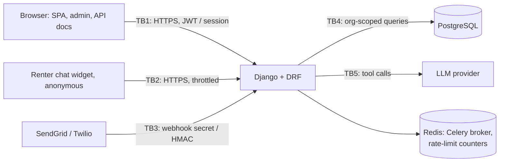

# Security

This document describes LeaseLoop's threat model, the controls that address each threat,
where those controls live in the code, and what is not covered yet. Every control listed
here has a test; file names are given so each claim can be checked.

To report a vulnerability, open a private security advisory on the GitHub repository
rather than a public issue.

## Assets

| Asset | Why it matters |
|---|---|
| Prospect and lease records | Renter PII (names, emails, phone numbers, income on applications) and the leasing pipeline of each customer organization |
| Tenant isolation | Each organization's data must be invisible to every other organization |
| Credentials and sessions | Passwords, JWT access tokens, refresh tokens, Django admin sessions |
| `DJANGO_SECRET_KEY` | Signs sessions, password-reset links and JWTs; whoever has it can mint a login for any user |
| Webhook secrets | SendGrid URL token and Twilio auth token; whoever has them can inject leads |
| Audit trail | Evidence of who changed what; only useful if it can't be rewritten |
| Availability of the API | Agents work leads in real time; webhooks must not be dropped |

## Trust boundaries

| Boundary | Untrusted side | What crosses it |
|---|---|---|
| TB1 | Any browser, including other sites' pages | Credentials, JWTs, cookies, CRM reads and writes |
| TB2 | Anyone on the internet | Chat messages, renter name and contact details |
| TB3 | Anyone who can reach the webhook URLs | Inbound email and SMS payloads |
| TB4 | Authenticated users of *other* organizations, and agents within an org | Object IDs in URLs and foreign keys in request bodies |
| TB5 | Model output, which can be steered by renter text (prompt injection) | Tool names and arguments |

## Threats and mitigations (STRIDE)

### Spoofing

| Threat | Mitigation | Code | Tests |
|---|---|---|---|
| Password guessing | 5 login attempts/min per client IP and 5/min per account (any IP, case-insensitive); counters in Redis so all workers share them | `backend/apps/core/throttling.py`, `LoginView` in `backend/apps/accounts/auth.py` | `tests/test_throttling.py` |
| Rate-limit bypass with a forged client IP | Client IP comes from the TCP peer; `X-Forwarded-For` is trusted only for `NUM_PROXIES` hops (default 0) | `REST_FRAMEWORK["NUM_PROXIES"]` in `backend/config/settings.py` | `test_spoofed_x_forwarded_for_does_not_reset_the_ip_budget` |
| Stolen access token reused for long | Access tokens live 15 minutes and are held in memory only, never in `localStorage` | `SIMPLE_JWT` in settings; `frontend/src/api/client.ts` | `test_expired_access_token_is_rejected`, `client.test.ts` |
| Stolen refresh token | 7-day lifetime; HttpOnly, Secure, `SameSite=Strict` cookie scoped to `/api/auth/`; rotated on every use, and the old token is blacklisted, so a replay is rejected; logout blacklists it | `backend/apps/accounts/auth.py` | `tests/test_auth_jwt.py` (rotation, reuse, logout, expiry) |
| Forged JWTs or sessions from a known secret key | Settings refuse to load with `DEBUG` off unless `DJANGO_SECRET_KEY` is a random value of 50+ characters | top of `backend/config/settings.py` | `test_settings_refuse_a_weak_secret_key_outside_debug` |
| Forged webhook deliveries | Twilio: HMAC-SHA1 signature over the public URL and parameters, compared in constant time. SendGrid: secret URL token, compared in constant time | `backend/apps/integrations/signatures.py`, `views.py` | `tests/test_webhooks.py` |
| Legacy long-lived API tokens | DRF `TokenAuthentication` removed; `Authorization: Token …` is rejected | settings | `test_legacy_drf_token_scheme_is_not_accepted` |

### Tampering

| Threat | Mitigation | Code | Tests |
|---|---|---|---|
| Cross-site request forgery on cookie-authenticated requests | Session-authenticated API writes need a CSRF token (DRF `SessionAuthentication`). The JWT endpoints, which act on the refresh cookie, accept JSON only and reject a foreign `Origin`, which also covers sibling subdomains that `SameSite=Strict` treats as same-site and blocks login CSRF | `TrustedOrigin`, `AuthView` in `backend/apps/accounts/auth.py` | `tests/test_security_headers.py` (CSRF and Origin tests) |
| Writing into another tenant through foreign keys | Foreign-key fields only accept objects from the caller's organization | `backend/apps/core/serializers.py` | `tests/test_tenancy.py` |
| Agents editing work that isn't theirs | Agents see and edit only their own or unassigned prospects and tours, can only assign to themselves, and can't approve applications | `backend/apps/crm/scoping.py`, `AgentAssignmentMixin` | `tests/test_rbac.py` |
| Out-of-order pipeline changes | Guarded state transitions (draft → submitted → approved → lease → signed) | `ApplicationViewSet`, `LeaseViewSet` | `tests/test_leasing_pipeline.py` |
| Replayed or duplicated webhooks | Ledger with a unique `(provider, event_id)`; duplicates are no-ops | `backend/apps/integrations/models.py` | `tests/test_webhooks.py` |
| MITM changing responses or stripping TLS | HTTPS redirect, HSTS for one year with subdomains, Secure cookies (production defaults when `DEBUG` is off) | settings | `test_hsts_is_sent_on_https_only`, `test_plain_http_is_redirected_to_https` |

### Repudiation

| Threat | Mitigation | Code | Tests |
|---|---|---|---|
| A user denies changing a prospect or lease | Append-only `AuditEvent` with actor, org, action, object, changed fields (old and new values), client IP and timestamp, written in the same transaction as the change; covers API create/update/delete of prospects and leases, lease creation from an application and lease signing | `backend/apps/audit/` | `tests/test_audit.py` |
| Login activity can't be traced | Login success and failure are recorded with IP, once per organization of the account; failures for unknown emails are kept without an org (admin only) | `record_login` in `backend/apps/audit/services.py` | `test_login_*` in `tests/test_audit.py` |
| Rewriting the trail | `save()` on an existing event and `delete()` raise; the API is list/retrieve only (PUT/PATCH/DELETE → 405); the admin is read-only | `backend/apps/audit/models.py`, `views.py`, `admin.py` | `test_trail_is_append_only` |

### Information disclosure

| Threat | Mitigation | Code | Tests |
|---|---|---|---|
| Reading another tenant's records | Every queryset is filtered by the caller's organization; foreign IDs return 404, not 403, so existence isn't leaked | `backend/apps/core/viewsets.py` | `tests/test_tenancy.py` |
| Reading the audit trail (which repeats PII) | Managers only, own organization only | `backend/apps/audit/views.py` | `test_managers_read_only_their_orgs_events`, `test_agents_and_anonymous_users_cannot_read_the_trail` |
| Token theft through XSS | Access token only in a JS variable; refresh token in an HttpOnly cookie that scripts can't read; CSP (`script-src 'self'`) on every Django-rendered page | `frontend/src/api/client.ts`, `CONTENT_SECURITY_POLICY` in settings | `client.test.ts`, `test_api_responses_carry_the_security_headers` |
| Other sites reading API responses | No CORS access unless an origin is in `CORS_ALLOWED_ORIGINS`, never with credentials | `CORS_*` in settings | `test_cors_*` |
| Clickjacking, MIME sniffing, referrer leaks | `X-Frame-Options: DENY`, `frame-ancestors 'none'`, `nosniff`, `Referrer-Policy: same-origin`, `Cross-Origin-Opener-Policy: same-origin` | settings | `test_api_responses_carry_the_security_headers` |
| API schema reveals the attack surface to anyone | `/api/schema/` and `/api/docs/` require authentication | `SPECTACULAR_SETTINGS` | `test_session_auth_still_works_for_admin_and_swagger` |
| The assistant revealing other residents' data or other tenants' units | Pre-filters for personal-data, legal, fair-housing and injection requests; tools look up data by the organization from server context, never from model output; a post-check blocks prices and unit numbers that no source supports | `backend/apps/assistant/guardrails.py`, `tools.py` | `tests/test_assistant_*` |

### Denial of service

| Threat | Mitigation | Code | Tests |
|---|---|---|---|
| Request floods | Defaults of 60/min per IP for anonymous endpoints and 600/min per authenticated user; refresh 30/min per IP; chat widget 30/min per IP | `DEFAULT_THROTTLE_*` in settings | `tests/test_throttling.py` |
| Limits turning into self-inflicted outages | Webhooks are exempt (signature-verified; a 429 would drop a lead). Throttles fail open if Redis is unreachable, so a cache outage doesn't become an API outage | `backend/apps/core/throttling.py` | `test_webhooks_are_not_throttled`, `test_throttles_fail_open_when_the_cache_is_down` |
| Locking a user out with forged refresh tokens | The refresh limit is keyed by IP, not by the user ID inside the token, because that ID isn't trusted until the token is verified | `RefreshView` | `test_refresh_is_throttled_per_ip` |

### Elevation of privilege

| Threat | Mitigation | Code | Tests |
|---|---|---|---|
| Agent performing manager actions | `IsManager` on approvals, membership management and the audit trail | `backend/apps/core/permissions.py` | `tests/test_rbac.py`, `tests/test_audit.py` |
| Picking another organization through the header | `X-Organization` is honoured only for organizations the user belongs to; otherwise 404 | `backend/apps/core/tenancy.py` | `tests/test_tenancy.py` |
| Prompt injection making the assistant act outside its role | Tool arguments are re-validated on the server (e.g. `book_tour` re-checks the slot); tools can't touch other organizations; injection phrases hand off to a person | `backend/apps/assistant/tools.py`, `guardrails.py` | `tests/test_assistant_*` |
| Exploiting a known-vulnerable dependency | CI fails on Semgrep ERROR/WARNING findings, on any known-vulnerable Python package and on high/critical npm advisories | `security` job in `.github/workflows/ci.yml` | the job itself |

## Dependency and static-analysis results

First run, November 2026, before fixes, and after:

| Scanner | Before | After | What was done |
|---|---|---|---|
| Semgrep `p/python` + `p/django` (152 rules, 107 files) | 0 findings | 0 | Checked that the rules were really loaded: a planted file with SQL injection, `shell=True` and unescaped HTML produced 5 findings |
| pip-audit | 26 advisories (Django 20, DRF 5, pytest 1) | **0** | Django 5.1.4 → 5.2.17 LTS (5.1 is end-of-life), DRF 3.15.2 → 3.18.2, pytest 8.3.4 → 9.0.3 |
| npm audit | 30 advisories (4 high, 21 moderate, 5 low) | **4** (3 moderate, 1 low), 0 high | react-router-dom 6.28.0 → 6.30.6, vite 5.4.11 → 6.4.6, postcss 8.4.49 → 8.5.32, eslint 9.17.0 → 9.39.5, typescript-eslint 8.18.1 → 8.72.2 |
| `manage.py check --deploy` | 4 warnings | 1 | Remaining: W021 (HSTS preload), opt-in on purpose |

Counts are unique advisory IDs; `npm audit`'s own summary counts each affected package in a
chain and reported 22 before and 16 after.

### Accepted findings

| Advisory | Package | Severity | Why it's accepted |
|---|---|---|---|
| GHSA-wrjc-x8rr-h8h6 | react-router 6.30 | moderate | Open redirect when a path passed to `<Link>`/`navigate()` comes from an attacker. Every navigation target in the app is a string constant or a numeric ID from our own API. The fix requires React Router 7 |
| GHSA-337j-9hxr-rhxg | react-router 6.30 | moderate | Affects server-side rendering hydration; the app is client-rendered only |
| GHSA-g3hv-75wg-m249 | minimatch (via typescript-eslint) | moderate | ReDoS on glob patterns at lint time only; the patterns are our own ESLint config. The latest typescript-eslint still depends on the affected range |
| GHSA-gcqx-w48m-w2h4 | deepmerge (via Jest) | low | Prototype pollution when merging Jest configuration that we write ourselves; test-time only |

Semgrep's free rulesets did **not** flag `pickle.loads(request.body)` or `@csrf_exempt` in
the planted file, so the scan complements code review rather than replacing it.

## Known limitations

- **Refresh-token reuse doesn't revoke the whole session family.** If an attacker steals a
  refresh token and uses it before the victim does, the attacker's chain continues and the
  victim is logged out at their next refresh. simplejwt blacklists the reused token but has
  no family tracking. Mitigations today: 7-day lifetime, HttpOnly cookie, rotation.
- **Access tokens can't be revoked early.** Logout revokes the refresh token; an access
  token already issued stays valid for up to 15 minutes.
- **No CSP on the React app itself.** The policy covers what Django serves (API, admin,
  docs). The SPA is served by Vite in development and needs the same headers from whatever
  static host serves it in production. XSS in the SPA could call the API with the in-memory
  token while the page is open, though it can't read the refresh cookie.
- **Audit coverage is partial.** Only API changes to prospects and leases, lease creation
  from an application, lease signing and logins are recorded. Changes made by webhooks,
  Celery jobs, the assistant and status side effects done with `QuerySet.update()` (for
  example a prospect becoming `APPLIED`) are not, nor are tours, applications or
  memberships. Append-only is enforced by the ORM and the API, not by the database: anyone
  with direct database access can still alter rows. There is no retention policy or alerting.
- **Rate-limit trade-offs.** Limits fail open while Redis is down. The per-account login
  limit lets anyone lock a known email out of logging in for up to a minute. Users behind
  one NAT share the per-IP budget. Behind a load balancer, `NUM_PROXIES` must match the
  real number of proxies, or every client shares one IP (too low) or can pick its own (too
  high). Throttled login attempts are not written to the audit trail.
- **No MFA and no breached-password check.** Passwords are checked only for minimum length
  and against Django's common-password list.
- **SendGrid's secret travels in the URL query string**, which proxies may log, because
  SendGrid Inbound Parse doesn't sign requests. Twilio's signature check depends on
  `WEBHOOK_PUBLIC_BASE_URL` matching the public URL.
- **The chat widget is anonymous by design.** Each new session creates a prospect, so a
  determined spammer can create up to 30 per minute per IP.
- **Assistant guardrails are pattern-based.** They cover the listed categories and the eval
  set, not every phrasing.
- **PII is not encrypted at field level**; it relies on database and disk encryption.
- **Static files aren't served when `DEBUG` is off** (no WhiteNoise or CDN configured), so a
  production deployment must serve `/static/` separately for the admin to render.

## Configuration checklist for production

- `DJANGO_DEBUG=false` and a random `DJANGO_SECRET_KEY` of 50+ characters (the app refuses
  to start otherwise).
- TLS in front of Django. If the proxy terminates TLS, set `TRUST_X_FORWARDED_PROTO=true`
  and `NUM_PROXIES` to the number of proxies.
- `DJANGO_ALLOWED_HOSTS` and `DJANGO_CSRF_TRUSTED_ORIGINS` set to the real host names and
  front-end origin.
- `CACHE_URL` / `REDIS_URL` pointing at a shared Redis, so rate limits are global.
- Real `SENDGRID_INBOUND_TOKEN`, `TWILIO_AUTH_TOKEN` and `WEBHOOK_PUBLIC_BASE_URL`.
- The same security headers (including a CSP) on the host that serves the React build.
