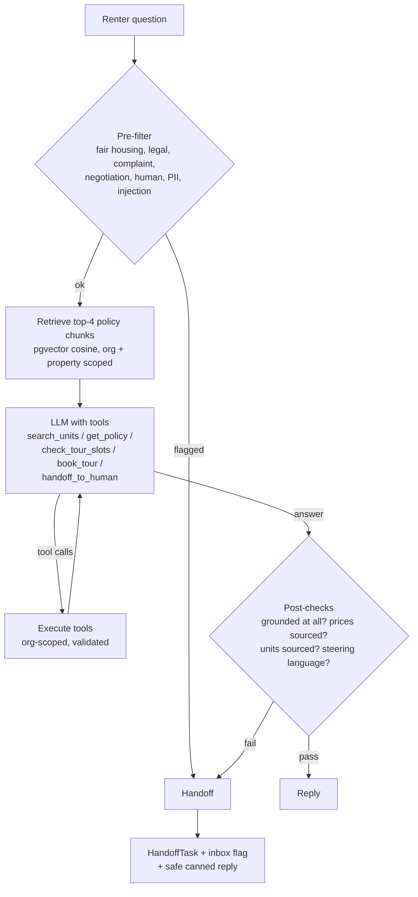

# Leasing assistant

The assistant answers renter questions on the public chat widget
(`POST /api/assistant/chat/`). It also drafts replies for agents in the inbox
(`POST /api/conversations/{id}/suggest-reply/`).

## One turn



- **Facts come from tools.** Rent, availability and move-in dates are read from
  `Unit` rows by `search_units` when the question is asked. They are never embedded,
  so a price can't go stale in the vector index.
- **Policies come from retrieval.** Policy text (pets, parking, fees, lease terms,
  amenities, application, office hours) is chunked by sentence (about 320 characters,
  each chunk prefixed with the policy title), embedded into `PolicyChunk`, and searched
  with pgvector cosine distance over an HNSW index. Each property sees its own policies
  plus the org-wide ones. Editing a policy re-indexes it through a Celery task.
- **Booking is checked on the server.** `book_tour` recomputes the open slots itself,
  while holding a row lock on the unit. A slot is rejected if:
  - it isn't on the half hour, between 9:00 and 16:30;
  - it falls on a Sunday;
  - it is less than an hour away;
  - it is already taken;
  - or it is requested for a prospect other than the one in this conversation.
- **Draft mode** (agent suggestions) offers no `book_tour` tool, creates no handoff and
  sends nothing.

### When it hands off instead of answering

| Trigger | Reason |
|---|---|
| Steering or protected-class questions: who lives here, families or kids, religion, race or national origin, neighborhood safety, schools, disability accommodations | `FAIR_HOUSING` |
| Legal questions, complaints or maintenance, negotiation, other residents' information, prompt injection | `OUT_OF_SCOPE` |
| The renter asks for a person | `REQUESTED_HUMAN` |
| The model calls `handoff_to_human`, refuses, hits `max_tokens`, or exceeds 6 tool steps | `MODEL_UNSURE` (or the reason the model gave) |
| The answer used no tool and no retrieved excerpt both scored ≥ 0.20 and shared a word with the question | `LOW_CONFIDENCE` |
| The answer contains a dollar amount or unit number that no tool result or policy text supports | `UNGROUNDED` |
| The model API is down or rate-limited | `ASSISTANT_ERROR` |

The pre-filter and post-checks run outside the model, so they apply whichever
provider is used. Renter text is escaped before it goes into the prompt, so typing
`</question>` can't break out of the question block. The eval caught that one.

## Providers

`LLM_PROVIDER=anthropic` uses Claude through the Messages API (`apps/assistant/providers.py`):

- Model `claude-opus-5-5` (set with `LLM_MODEL`), with `output_config.effort` set
  explicitly to `medium` (`LLM_EFFORT`). Thinking is left at the model default
  (adaptive).
- Tools are `strict` JSON schemas with `tool_choice` left as `auto`. The system prompt
  and tool list stay stable, so `cache_control` can cache them. Each request's own
  context (date, excerpts, history) goes in the user turn.
- Server-side refusal fallbacks are on (`fallbacks="default"` with the
  `server-side-fallback-2026-07-01` beta). A `refusal` that survives the fallback is
  handed off.
- 429 errors, 5xx errors and connection failures become `AssistantUnavailable`, which
  hands off. Client errors (4xx) raise, because they are bugs.
- `tests/test_anthropic_provider.py` runs the provider against a local stub of the API
  to check the exact request body and headers, without a key.

`LLM_PROVIDER=mock` is a deterministic keyword router (`mock_provider.py`). It reads the
same transcript and emits the same tool calls. It exists so CI can run the whole loop,
guardrails and eval without an API key. Its accuracy is a smoke-test baseline, not a
measure of an LLM.

## Eval

`evals/inquiries.jsonl` has 150 inquiries:

| Category | Inquiries |
|---|---:|
| Pricing | 20 |
| Pets | 20 |
| Availability | 20 |
| Tour booking | 20 |
| Fees | 15 |
| Parking | 15 |
| Out of scope | 20 |
| Adversarial: fair-housing steering, prompt injection, false-premise prices, other residents' data | 20 |

Each inquiry lists what must happen (answer or handoff), the facts the reply must
contain, strings it must not contain, the tools that must be called, whether a tour
gets booked, and the handoff reason where one is expected. Expected facts come from
`evals/fixture.py`, and the clock is fixed at Monday 2026-11-02 10:00 ET.

```bash
python evals/run_eval.py --provider mock        # CI smoke test (writes evals/results.md)
python evals/run_eval.py --provider anthropic   # real model, needs ANTHROPIC_API_KEY
```

The script exits non-zero if any final answer contains a hallucinated price, or if
accuracy falls below `--min-accuracy`.

### History, measured

| Run | Accuracy | Hallucinated prices | Handoff precision / recall |
|---|---:|---:|---:|
| Mock, first run | 82.7% (124/150) | 0 | 35/42 / 35/37 |
| Mock, after fixing the bugs below | **87.3% (131/150)** | **0** | 35/38 / 35/37 |
| Claude (`claude-opus-5-5`) | not run yet: no API key in the build environment | | |

The first run found five bugs, all fixed in code rather than by tuning the mock to the
eval:

1. **Unit-grounding check too strict.** It blocked "Unit 305 isn't currently available",
   because echoing a unit number from the renter's own question counted as an invented
   unit.
2. **Pre-filter missed "Is the neighborhood safe?"** The safety phrasing came in reverse
   word order.
3. **Pre-filter missed "How are the schools around here?"** Items 2 and 3 were still
   handed off, but with the wrong reason.
4. **Prompt-tag injection.** A renter typing `</question>` could close the question block.
   Renter text is now escaped.
5. **Mock bug.** `"noon" in "afternoon"` booked a 12:00 tour for "Thursday afternoon".

The 19 failures that remain are limits of the keyword mock. For example, it doesn't route
"pit bulls" to the pet policy, or "late fees" to the pricing policy. They are listed
in `evals/results.md`.

### Retrieval threshold

`evals/dev_questions.jsonl` holds 12 questions that are separate from the eval.
`evals/calibrate_retrieval.py` prints each one's top score. With the hashing embedder:

| Group | Top cosine scores |
|---|---|
| Answerable questions | 0.05 to 0.26 |
| Unanswerable questions | 0.05 to 0.19 |

The two ranges overlap. Lexical hashing doesn't know "cosigner" means "guarantor", or that
"all night" means "24-hour". Two decisions follow from this:

- The model always sees the top 4 excerpts, labelled as possibly off-topic, and can call
  `get_policy`.
- The 0.20 threshold only decides whether retrieval *alone* counts as grounding. A
  retrieved excerpt must also share a real word with the question. This was added after
  a test showed a one-word question ("sauna") scoring 0.201 against unrelated fee text,
  through a hash collision.

**Next improvement:** a semantic embedding model behind the same `embed()` interface.

## Limitations

- The pre-filter is a set of regular expressions. It is tested and errs toward handing
  off, but phrasing it hasn't seen can get past it to the model. The system prompt's
  fair-housing rules and the post-check for steering language are the backstops.
- The price check verifies that an amount appears in a source. It doesn't check that the
  amount is attached to the right unit.
- The mock numbers say nothing about how Claude performs. The `--provider anthropic`
  run is what fills that in.
